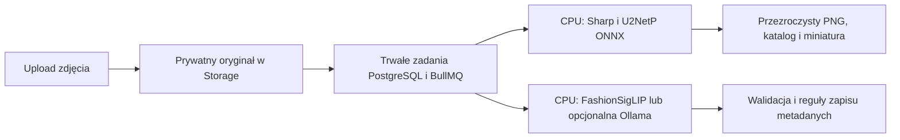
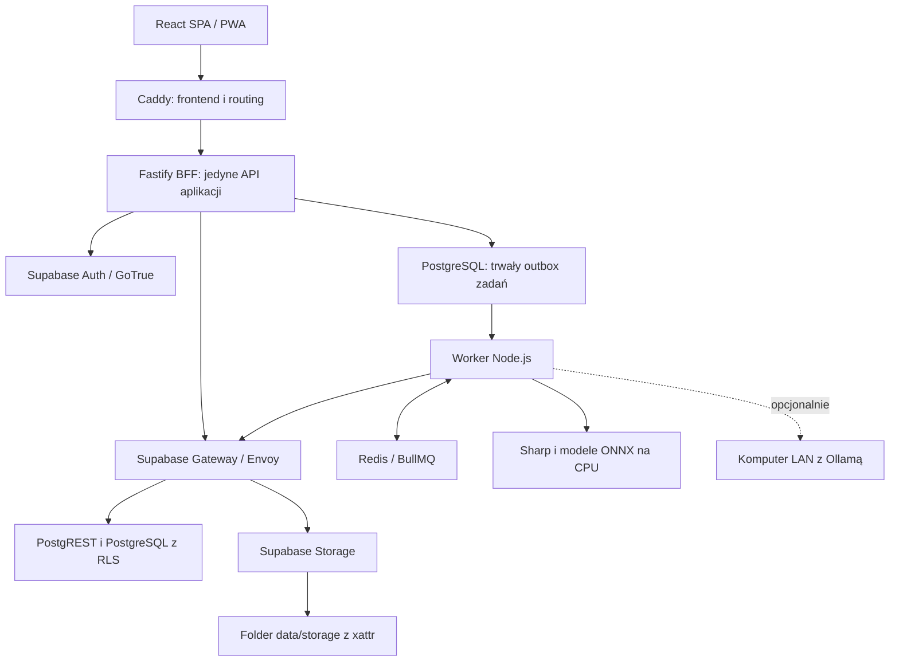

# Smart Wardrobe

**Prywatna garderoba cyfrowa z polskim interfejsem, lokalną analizą zdjęć i propozycjami stylizacji z ubrań, które naprawdę posiadasz.**

Smart Wardrobe pomaga uporządkować ubrania własne i rodzinne: przesłać zdjęcia, przygotować fotografie katalogowe, rozpoznać kategorię i kolor, kontrolować pranie oraz zapisywać zestawy. Aplikacja jest self-hosted — konta, baza i zdjęcia pozostają na Twojej infrastrukturze. Nie wymaga konta Supabase Cloud ani płatnego API AI.

To React SPA dla komputera i telefonu, uruchamiana wraz z całym zapleczem przez **jeden główny Docker Compose**. Domyślna analiza ubrań i usuwanie tła działają na CPU. Ollama na osobnym komputerze LAN jest opcjonalna.

## Spis treści

- [Co potrafi aplikacja](#co-potrafi-aplikacja)
- [Uruchomienie](#uruchomienie)
- [Jak używać](#jak-używać)
- [Zdjęcia i analiza AI](#zdjęcia-i-analiza-ai)
- [Architektura](#architektura)
- [Konfiguracja](#konfiguracja)
- [Administracja i utrzymanie](#administracja-i-utrzymanie)
- [Development i testy](#development-i-testy)
- [Ograniczenia](#ograniczenia)
- [Dokumentacja](#dokumentacja)

## Co potrafi aplikacja

| Obszar      | Funkcje                                                                                                      |
| ----------- | ------------------------------------------------------------------------------------------------------------ |
| Konto       | Rejestracja, logowanie, wylogowanie, odzyskiwanie hasła, profil i ustawienia                                 |
| Garderoby   | Prywatne i rodzinne przestrzenie, członkowie, role i zaproszenia                                             |
| Katalog     | Wyszukiwanie, filtrowanie, ulubione, edycja, archiwizacja i usuwanie ubrań                                   |
| Import      | Pojedyncze ubrania lub do 200 zdjęć w partii; jedno zdjęcie importu tworzy jedno ubranie                     |
| Fotografie  | Zachowany oryginał, usunięte tło, przezroczysty PNG, zdjęcie katalogowe i miniatura                          |
| Orientacja  | Ręczny obrót w krokach 90°, podgląd i ponowne przetwarzanie bez nadpisania oryginału                         |
| Analiza     | Lokalna klasyfikacja kategorii, koloru i wzoru przez FashionSigLIP; opcjonalna analiza Ollama i odczyt metek |
| Metadane    | Automatyczne nazwy, reguły ciepłoty 1–5, sugestie do akceptacji i opcja automatycznego nadpisywania          |
| Stylizacje  | Propozycje z dostępnych ubrań, zapis zestawów, dobór opcjonalnego paska                                      |
| Użytkowanie | Statusy prania i historia noszenia                                                                           |
| Zadania     | Przetwarzanie w tle, postęp, błędy i ponawianie; administracyjny Bull Board                                  |
| Telefon     | Responsywny interfejs, nawigacja mobilna i PWA                                                               |

## Uruchomienie

### Wymagania

- Linux z Docker Engine i Compose lub **macOS z OrbStack**.
- Node.js 26 do przygotowania konfiguracji; pnpm 12 do pracy nad kodem.
- Jako punkt startowy: 4 vCPU, 8 GB RAM i 40–60 GB SSD **plus zdjęcia, modele i backupy**. To zalecenie, nie wynik benchmarku N100/N150. Nie zakładamy, że pełny stos zmieści się w 4 GB RAM.
- Internet podczas pierwszego przygotowania obrazów i pobierania modeli CPU.

Na macOS standardowy backend plikowy Supabase wymaga silnika, który poprawnie obsługuje linuksowe xattr na folderach Maca. W tym projekcie sprawdzono **OrbStack**; współdzielenie plików Docker Desktop zwracało `ENOTSUP`. Sam APFS nie rozwiązuje problemu warstwy udostępniania. [Szczegóły Storage](infra/storage/README.md).

### Nowa instalacja

```sh
# Na Macu najpierw uruchom OrbStack:
docker context use orbstack

# W katalogu repozytorium:
node scripts/setup.mjs
```

Na Linuxie pomiń wybór kontekstu OrbStack. Setup tworzy lokalny `.env` z losowymi sekretami; istniejącego pliku nie nadpisuje. Sprawdź adresy i ustawienia poczty przed startem.

Przed pierwszym buildem przygotuj wagi CPU, których nie przechowujemy w Git: [FashionSigLIP — pobranie i SHA-256](infra/models/fashion-siglip/README.md). Model usuwania tła `u2netp.onnx` również musi znajdować się w `infra/models/`, zgodnie z [opisem i SHA-256](infra/models/README.md). [Dockerfile usług Node](infra/Dockerfile.node) kopiuje lokalne wagi do obrazu; nie zastępuje ich pobrania.

```sh
docker compose up -d --build
docker compose ps
```

Nie uruchamiaj osobnego wdrożenia Supabase. Usługa `migrate` jest jednorazowa — po sukcesie ma stan zakończony, a nie stale działający.

### Istniejąca instalacja na Macu

```sh
cd ~/Desktop/Projekty/adw-smart-wardrobe
docker context use orbstack
docker compose up -d --build
```

**Zmiana kontekstu nie przenosi danych.** Powyższe dotyczy już zmigrowanego środowiska. Przy przenoszeniu innej instalacji najpierw zabezpiecz i przenieś wolumeny PostgreSQL/Redis oraz pliki Storage z xattr. Nie uruchamiaj tej samej instalacji równolegle w dwóch silnikach.

### Adresy lokalne

| Usługa          | Adres                                   | Dostęp                                                            |
| --------------- | --------------------------------------- | ----------------------------------------------------------------- |
| Aplikacja       | http://localhost:8080                   | Konto Smart Wardrobe                                              |
| OpenAPI         | http://localhost:8080/api/docs          | Dokumentacja REST API                                             |
| JSON OpenAPI    | http://localhost:8080/api/docs/json     | Specyfikacja API                                                  |
| Supabase Studio | http://localhost:8000                   | Basic Auth: `DASHBOARD_USERNAME` i `DASHBOARD_PASSWORD` z `.env`  |
| Bull Board      | http://localhost:8080/api/admin/queues/ | Sesja aplikacji i konto dopuszczone przez `QUEUE_ADMIN_USER_IDS`  |
| PostgreSQL      | `127.0.0.1:54322`                       | Użytkownik `postgres`, baza `postgres`, hasło `POSTGRES_PASSWORD` |

Studio i PostgreSQL są ograniczone do loopback hosta. Hasło Studio nie jest hasłem konta aplikacji. Redis nie ma opublikowanego portu.

## Jak używać

### 1. Załóż konto i utwórz garderobę

1. Otwórz aplikację i wybierz rejestrację albo zaloguj się.
2. Użyj przycisku **Utwórz garderobę** lub przycisku przy selektorze garderoby.
3. Wybierz prywatną lub rodzinną przestrzeń i nadaj jej nazwę.
4. Wybieraj aktywną garderobę w selektorze aplikacji — import i propozycje zestawów dotyczą tej przestrzeni.

Rejestracja bez potwierdzenia zależy od `ENABLE_EMAIL_AUTOCONFIRM`. Odzyskiwanie hasła wymaga działającej poczty SMTP. Aplikacja nie potrafi dostarczyć wiadomości bez skonfigurowanego serwera.

### 2. Dodaj jedno ubranie

Otwórz **Moja garderoba → Dodaj ubranie** lub `/garments/new`. Wybierz zdjęcie i zapisz ubranie. Nazwa jest opcjonalna: bez niej aplikacja przydziela unikalną nazwę tymczasową. Po udanej analizie może zastąpić ją polską nazwą katalogową; ręcznie nadana nazwa pozostaje chroniona.

Ubranie pojawia się w katalogu przed zakończeniem obróbki. Otwórz jego szczegóły, aby zobaczyć status zdjęcia i analizę. Możesz samodzielnie uzupełniać metadane bez czekania na AI.

### 3. Zaimportuj wiele ubrań

Otwórz **`/garments/import`**, np. http://localhost:8080/garments/import.

1. Wybierz właściwą garderobę.
2. Przeciągnij zdjęcia lub zaznacz wiele plików w oknie wyboru.
3. Jedna partia może zawierać **do 200 zdjęć JPEG/PNG/WebP, maksymalnie 10 MB każde**. HEIC nie jest obsługiwanym formatem tego formularza — wcześniej przygotuj JPEG.
4. Obserwuj postęp i komunikaty przy poszczególnych plikach. Nieudane przesłanie można ponowić.

Upload ma współbieżność 3, a analiza działa w osobnej kolejce. Jeden błąd nie anuluje całej partii. „Gotowe” oznacza przygotowanie zdjęcia katalogowego; metadane AI mogą pojawić się później.

Możesz przechodzić między ekranami, ale **nie zamykaj ani nie odświeżaj karty podczas uploadu** — lista plików oczekujących jest w pamięci przeglądarki. Już przesłane ubrania i zadania są trwałe i przetwarzają się na serwerze.

### 4. Popraw zdjęcie lub metadane

W szczegółach ubrania (`/garments/<id>`) możesz obejrzeć wersję katalogową, oryginał i wycięcie oraz przejść do edycji.

Aby poprawić orientację, użyj **Obróć w lewo / Obróć w prawo**, sprawdź podgląd, a następnie **Zapisz obrót** albo **Anuluj**. Zapis zleca odtworzenie zdjęć pochodnych. Oryginał pozostaje bez zmian; wybrany obrót jest trwały i nie powinien być zastępowany sugestią modelu.

Do pojedynczej ponownej analizy służy **Powtórz analizę AI**. Postęp jest odświeżany automatycznie. To inna operacja niż ponowne usuwanie tła.

### 5. Zdecyduj o automatycznym zapisie AI

W **Ustawieniach** (`/settings`) znajduje się opcja:

> Pozwalaj AI na nadpisywanie metadanych ubrań

Domyślnie jest wyłączona. Pierwsza analiza nowego, nieedytowanego ubrania może automatycznie uzupełnić dane; późniejsze zmiany wymagają akceptacji zgodnie z dotychczasowym procesem. Włączenie opcji zezwala również na automatyczne aktualizowanie obsługiwanych parametrów przy ponownej analizie, także wcześniej poprawionych ręcznie.

Opcja jest zapisywana osobno dla użytkownika. Nie uruchamia analizy sama z siebie. Nie nadpisuje ręcznych nazw i notatek, zdjęć, właściciela ani relacji. Puste i nierozpoznane wartości są pomijane. Edycja w trakcie analizy blokuje automatyczny zapis nieaktualnego wyniku.

W ustawieniach przy garderobie możesz zlecić analizę wszystkich jej ubrań. Wykorzystuje ona zapisane ręczne obroty. To potencjalnie długa operacja — nie trzeba pozostawać na ekranie.

### 6. Korzystaj ze stylizacji i prania

- **Stylizacje** (`/outfits`): wybierz okazję i temperaturę, kliknij **Zaproponuj zestawy**. Potrzebujesz poprawnie skategoryzowanej, dostępnej góry i dołu albo sukienki. Propozycje korzystają z rzeczywistych identyfikatorów ubrań aktywnej garderoby.
- **Zapisane zestawy** (`/saved`): wracaj do zapisanych propozycji. Dostępne są działania związane z noszeniem zestawu.
- **Pranie** (`/laundry`): zmieniaj statusy: czyste, noszone, brudne, w praniu, suszenie i prasowanie. Dostępność ubrań wpływa na propozycje.

Generator stosuje reguły i różnicuje propozycje; nie gwarantuje unikalnych zestawów przy małej liczbie rzeczy. Do pasujących spodni może dodać posiadany pasek, uwzględniając kolor, styl i buty. Nie dodaje go do dresów czy legginsów.

### 7. Udostępnij lub usuń garderobę

Na ekranie **Rodzina** (`/family`) zarządzaj członkami i zaproszeniami. Role: właściciel, edytor i przeglądający. Link zaproszenia jest przypisany do adresu e-mail; nie zakładaj, że został automatycznie wysłany pocztą.

W **Ustawieniach → Twoje garderoby** właściciel może usunąć garderobę. Najpierw pojawia się potwierdzenie z informacją, że znikną również ubrania, zdjęcia, zestawy i historia tej garderoby — także rzeczy pozostałych członków. Konto użytkownika pozostaje zachowane. Czyszczenie plików i kolejek może dokończyć się w tle.

## Zdjęcia i analiza AI

### Dwa niezależne procesy



Obróbka normalizuje EXIF, uwzględnia zapisany obrót, usuwa tło modelem segmentacji, kadruje i przygotowuje pochodne pliki. Nie generuje nowego wyglądu ubrania i nie usuwa zagnieceń generatywnie. Jakość krawędzi zależy od zdjęcia, kontrastu i modelu. **Gotowe zdjęcie nie oznacza zakończonej analizy metadanych.**

### FashionSigLIP — domyślny klasyfikator CPU

`GARMENT_ANALYSIS_PROVIDER=fashion-siglip` wykorzystuje lokalny encoder ONNX `Marqo/marqo-fashionSigLIP` oraz przygotowane opisy kategorii. Rozpoznaje kategorię, kolor i wzór; podobieństwa embeddingów **nie są skalibrowanymi procentami pewności**. Model może się mylić, zwłaszcza przy podobnych krojach i trudnym tle.

Ręczny obrót jest nadrzędny. Porównywanie kategorii dla kilku orientacji nie jest dowodem właściwego ułożenia ubrania i nie obraca automatycznie zapisanych zdjęć. Materiał, rozmiar i marka nie są wiarygodnie wyznaczane przez ten klasyfikator.

Ciepłota wynika ze wspólnych reguł: T-shirt/top/szorty 1, koszula/polo/zwykłe długie spodnie 2, bluza/sweter/marynarka 3, kurtka przejściowa 4, zimowa 5. Zmiana kategorii przelicza formularz; ręczna korekta ma pierwszeństwo w bieżącej edycji. Akcesoria nie zwiększają ciepłoty stylizacji.

### Ollama — opcjonalny komputer LAN

Dla dostawcy Ollama ustaw `GARMENT_ANALYSIS_PROVIDER=ollama`, `OLLAMA_BASE_URL` na adres komputera w LAN i `OLLAMA_VISION_MODEL` na już zainstalowany model vision. W dotychczasowych testach używano m.in. `qwen3-vl:8b`. Nie używaj `localhost` jako adresu innego komputera z perspektywy kontenera.

Ollama nie jest uruchamiana w tym Compose. Jest również używana do opcjonalnej analizy metek. Odczytany skład/rozmiar wymaga czytelnej metki i weryfikacji, a nie zgadywania z wyglądu tkaniny. Niedostępność komputera AI nie blokuje konta, katalogu ani lokalnej obróbki. Zadania mają retry/backoff; po wyczerpaniu prób mogą wymagać ręcznego ponowienia. Nie obiecujemy nieskończonego automatycznego retry.

## Architektura



| Warstwa          | Technologia i odpowiedzialność                                                                                    |
| ---------------- | ----------------------------------------------------------------------------------------------------------------- |
| Web              | React, Vite, TypeScript, TanStack Router/Query/Table, Tailwind, komponenty Radix, React Hook Form/Zod, PWA        |
| API/BFF          | Fastify, walidacja Zod, REST/OpenAPI, Pino, sesje, autoryzacja, uploady i zlecanie zadań                          |
| Worker           | BullMQ, Sharp, ONNX Runtime; przetwarzanie zdjęć i analiza bez blokowania żądań HTTP                              |
| Tożsamość i dane | Self-hosted Supabase: GoTrue, PostgreSQL, PostgREST, prywatny Storage                                             |
| Infrastruktura   | Jeden Compose; Caddy, Envoy, Studio, Realtime, imgproxy, postgres-meta, Edge Runtime, Supavisor i trwałe wolumeny |

Baseline Supabase to przypięte oficjalne wydanie self-hosted **0.8.4**; źródła i sumy są w `infra/supabase/provenance.json`. Ten baseline używa Envoy. Generator `scripts/compose.mjs` odtwarza główny Compose z wersjonowanej konfiguracji upstream.

### Granice bezpieczeństwa

Przeglądarka rozmawia z BFF, nie z bazą, Redisem czy uprzywilejowanym Supabase. BFF korzysta z tożsamości zalogowanego użytkownika, a uprawnienia egzekwują również polityki RLS. Worker ma osobne uprawnienia do kontrolowanych operacji wewnętrznych.

Sesja to HttpOnly cookie; tokeny Supabase są szyfrowane po stronie serwera. Nie zapisujemy ich w localStorage. Mutacje wymagają kontroli Origin i CSRF. Zdjęcia są prywatne i pobierane przez autoryzowane API. PWA nie utrwala prywatnych odpowiedzi ani zdjęć w cache offline.

PostgreSQL jest trwałym źródłem stanu biznesowego zadań. Redis obsługuje transport i blokady; jego utrata nie powinna oznaczać utraty jedynej kopii zleceń. Przetwarzanie zdjęć i analiza mają osobne kolejki, każda z ograniczoną współbieżnością 1.

### Struktura repozytorium

```text
apps/web/               interfejs i klient REST
apps/api/               Fastify, sesje, endpointy i migrator
apps/worker/            kolejki, obróbka i dostawcy analizy
packages/shared/        schematy Zod, typy i reguły domenowe
supabase/migrations/    uporządkowane migracje SQL
infra/supabase/         przypięty oficjalny baseline
infra/models/           konfiguracja i lokalne wagi CPU; wagi poza Git
infra/storage/          opis natywnego backendu i test izolowany
infra/auth-email/       polskie szablony wiadomości Auth
docs/                   wdrożenie, eksploatacja, decyzje i postęp
data/storage/          aktywne pliki zdjęć, poza Git
investigation/         prywatne raporty, eksperymenty i backupy, poza Git
docker-compose.yml     całe wdrożenie
```

## Konfiguracja

Wzór zmiennych: [`.env.example`](.env.example). Sekrety zapisuj wyłącznie lokalnie, poza Git.

| Zmienna                                               | Zastosowanie                                                                   |
| ----------------------------------------------------- | ------------------------------------------------------------------------------ |
| `APP_ORIGIN`                                          | Główny adres aplikacji                                                         |
| `APP_ADDITIONAL_ORIGINS`                              | Dokładne dodatkowe originy, np. adres telefonu przez LAN; lista po przecinkach |
| `SITE_URL`, `SUPABASE_PUBLIC_URL`, `API_EXTERNAL_URL` | Publiczne adresy i poprawne linki Auth; ustawiaj spójnie z wdrożeniem          |
| `COOKIE_SECURE`                                       | `false` dla lokalnego HTTP; `true` dla HTTPS                                   |
| `SITE_ADDRESS`, `HTTP_PORT`, `HTTPS_PORT`             | Routing i porty Caddy                                                          |
| `GARMENT_ANALYSIS_PROVIDER`                           | `fashion-siglip` lub `ollama`                                                  |
| `OLLAMA_BASE_URL`, `OLLAMA_VISION_MODEL`              | Opcjonalny serwer LAN i model vision                                           |
| `SMTP_*`                                              | Dostarczanie wiadomości rejestracji i odzyskiwania hasła                       |
| `ENABLE_EMAIL_AUTOCONFIRM`                            | Rejestracja bez obowiązkowego potwierdzenia w konfiguracji developerskiej      |
| `QUEUE_ADMIN_USER_IDS`                                | Lista UUID kont dopuszczonych do administracji kolejkami; pusta wyłącza panel  |
| `DASHBOARD_USERNAME`, `DASHBOARD_PASSWORD`            | Ochrona Studio                                                                 |

### Telefon w LAN i PWA

Dodaj dokładny `http://<IP-komputera>:8080` do `APP_ADDITIONAL_ORIGINS` w `.env`, a potem odtwórz API:

```sh
docker compose up -d --no-deps api
```

Na telefonie otwórz ten sam adres IP z portem 8080. Zmiana IP komputera wymaga aktualizacji originu. Nie ustawiaj wildcardu. Pełna instalowalność PWA i service worker wymagają bezpiecznego kontekstu HTTPS; zwykły HTTP na adresie LAN nie daje tych samych możliwości co localhost.

### Poczta developerska

Można korzystać z istniejącego lokalnego serwera SMTP przez profil `dev-mail` i relay Node.js. Nie jest to konfiguracja produkcyjna. Host Maca z kontenera to `host.docker.internal`, a nie `localhost`. Szczegóły w [konfiguracji wiadomości](infra/auth-email/README.md) i komentarzach `.env.example`. Nie commituj loginu ani hasła SMTP.

## Administracja i utrzymanie

```sh
docker compose ps
docker compose logs --tail=100 api worker storage
curl --fail http://localhost:8080/api/health

# Zatrzymanie z zachowaniem danych:
docker compose stop

# Start bez celowego przebudowywania obrazów:
docker compose up -d
```

### Kolejki

Po zalogowaniu kontem administratora otwórz `/api/admin/queues/`. Uprawnienia nadaje konfiguracja UUID, nie sam dostęp do Studio. Panel umożliwia inspekcję stanów BullMQ; sterowanie anulowaniem kolejek jest dostępne pod `/api/admin/queue-control` zgodnie z routingiem BFF. Dla pojedynczego ubrania używaj przycisku ponownej analizy na jego szczegółach.

Historia Redis ma retencję **do 7 dni, maksymalnie 1000 wpisów** dla zakończonych i błędnych zadań. To dwa ograniczenia: przekroczenie limitu liczby może usunąć wpis wcześniej niż po 7 dniach. Trwały stan aplikacyjny znajduje się również w PostgreSQL.

### Zdjęcia i backupy

Aktywne zdjęcia znajdują się w **`./data/storage/`**, bez okresowego eksportu czy synchronizacji z ukrytym wolumenem. Supabase zachowuje katalogi i wersje obiektów: katalog może nazywać się `cutout.png`, a plik w nim mieć nazwę UUID bez rozszerzenia. To nadal zwykły obraz; można użyć Podglądu lub Quick Look. Nie zmieniaj nazw ani nie usuwaj go ręcznie.

**Pełny backup wymaga PostgreSQL, zdjęć wraz z xattr, kluczy i konfiguracji.** Suma SHA256 potwierdza bajty obrazu, nie zachowanie atrybutów. Nie wykonuj `docker compose down -v`, resetu Supabase ani ręcznego kasowania PGDATA podczas diagnostyki. Procedura: [backupy i odtwarzanie](docs/operations.md).

### Najczęstsze problemy

| Objaw                             | Co sprawdzić                                                                   |
| --------------------------------- | ------------------------------------------------------------------------------ |
| `ENOTSUP` przy zdjęciach          | Kontekst Docker i obsługę xattr; na Macu użyj zweryfikowanego OrbStack         |
| Zdjęcie gotowe, brak metadanych   | Oddzielne zadanie analizy, logi workera, plik wag i wybranego dostawcę         |
| Ollama nie odpowiada              | Adres LAN i model vision; lokalny katalog i usuwanie tła nie wymagają Ollamy   |
| Import przerywa się               | Format/rozmiar plików, błędy poszczególnych pozycji; nie zamykaj karty uploadu |
| Zestawy się nie pojawiają         | Aktywną garderobę, kategorie góra/dół, czystość i dostępność ubrań             |
| Logowanie na telefonie nie działa | Dokładny origin LAN w `.env` i odtworzenie API                                 |
| Brak wiadomości resetu hasła      | Działającą konfigurację SMTP; sam HTTP 200 nie potwierdza dostarczenia         |
| Studio odrzuca hasło              | Dane `DASHBOARD_*`, nie hasło użytkownika Smart Wardrobe                       |

## Development i testy

Repozytorium używa Node **26.13.0**, pnpm **12.18.0**, strict TypeScript i przypiętego lockfile.

```sh
npm install -g pnpm@12.18.0
pnpm install --frozen-lockfile
pnpm typecheck
pnpm lint
pnpm test
pnpm build
```

Dodatkowe testy wymagają pełnego stosu developerskiego:

```sh
pnpm exec playwright install chromium
pnpm test:stack
pnpm test:e2e
```

`test:stack` tworzy własne konta i dane, testuje m.in. REST, RLS i Storage oraz sprząta po sukcesie. E2E może pozostawiać dane oznaczone E2E do obejrzenia. Nie uruchamiaj tych testów na danych produkcyjnych bez sprawdzenia ich zakresu.

`pnpm dev` uruchamia Vite na 5173 z proxy do API na 3000. Nie uruchamia automatycznie całego backendu. Port BFF nie jest domyślnie publiczny w Compose; lokalny development API wymaga świadomej konfiguracji. Główną drogą uruchamiania pełnego systemu pozostaje Compose.

Po zmianie konfiguracji infrastruktury generator uruchamia się z katalogu głównego:

```sh
node scripts/compose.mjs
docker compose config --quiet
```

Migracje SQL są uporządkowane i mają sprawdzane checksumy. Nie edytuj już zastosowanych migracji; dodaj nową, przetestowaną migrację. Aktualizacja istniejącej instalacji wymaga backupu i przeglądu oczekujących migracji przed `up --build`.

## Ograniczenia

- Rozpoznawanie kategorii, kolorów i wzorów jest omylne; automatyczny zapis nie jest gwarancją poprawności.
- Nie ufamy kątom obrotu proponowanym przez LLM. Ręczna korekta jest dostępna i nadrzędna.
- Nie odgadujemy składu i rozmiaru ze zwykłego zdjęcia ubrania.
- Stylizacje opierają się na regułach i ręcznie podanej temperaturze; nie ma automatycznej integracji pogodowej ani realistycznych wizualizacji ComfyUI.
- Nie wdrożono generatywnego wygładzania ubrań ani gwarantowanej jakości fotografii produktowej.
- Offline działa powłoka PWA; prywatny katalog, zdjęcia i edycja wymagają połączenia.
- Przenoszenie ubrania wraz z plikami do innej garderoby wymaga osobnej obsługi i pozostaje ograniczeniem.
- Zapis SQL i obiektów Storage nie stanowi jednej transakcji — po awarii może być potrzebne ponowienie lub sprzątanie.

Ostatnia zakończona weryfikacja migracji do OrbStack obejmowała 97 testów, lint, TypeScript, zgodność 548 zdjęć, rzeczywisty upload/download i odmowę dostępu innemu użytkownikowi. To zapis konkretnego sprawdzenia, nie automatyczna gwarancja bieżącego stanu każdej instalacji. Szczegółowe wyniki i nieweryfikowane scenariusze są w raporcie postępu.

## Dokumentacja

- [Proxmox LXC, HTTPS i wdrożenie](docs/deployment-proxmox.md)
- [Szczegóły architektury i decyzje](docs/architecture.md) — historyczne opisy czytaj wraz z aktualnym raportem postępu
- [Eksploatacja, backup i restore](docs/operations.md)
- [Natywny Storage, OrbStack i xattr](infra/storage/README.md)
- [Model FashionSigLIP](infra/models/fashion-siglip/README.md)
- [Szablony wiadomości Auth](infra/auth-email/README.md)
- [Postęp, testy i znane ograniczenia](docs/progress.md)
- [Konwencje pracy nad projektem](AGENTS.md)

Nie dodawaj do Git `.env`, zdjęć, wolumenów, prywatnych raportów, backupów ani wag modeli. Katalogi `data/` i `investigation/` są celowo ignorowane.
