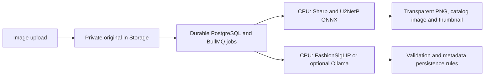
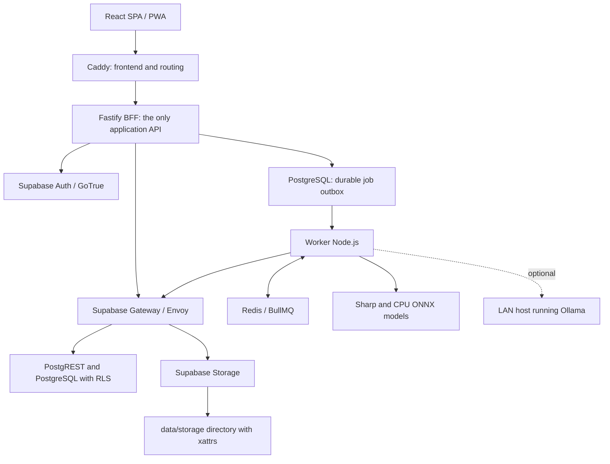

# Smart Wardrobe

**A private digital wardrobe with English and Polish interfaces, local image analysis, and outfit recommendations using garments you actually own.**

Smart Wardrobe helps organize personal and family clothing: upload images, prepare catalog photographs, identify categories and colors, manage laundry, save outfits, and create smart packing lists for trips. The application is self-hosted: accounts, data, and photos stay on your infrastructure. The core wardrobe and CPU image pipeline do not require Supabase Cloud or a paid AI API. Gemini-powered outfit and packing enrichment requires a user-configured Gemini credential.

This React SPA works on desktop and mobile and runs with its entire backend through **one root Docker Compose configuration**. Default garment analysis and background removal run on the CPU. Ollama on a separate LAN computer is optional.

## Contents

- [Development Guide](#development-guide)
- [Application features](#application-features)
- [Getting started](#getting-started)
- [Using the application](#using-the-application)
- [Images and AI analysis](#images-and-ai-analysis)
- [Architecture](#architecture)
- [Configuration](#configuration)
- [Administration and maintenance](#administration-and-maintenance)
- [Development and tests](#development-and-tests)
- [Limitations](#limitations)
- [Documentation](#documentation)

## Application features

| Area           | Features                                                                                                                                                                                                  |
| -------------- | --------------------------------------------------------------------------------------------------------------------------------------------------------------------------------------------------------- |
| Account        | Registration, sign-in, sign-out, password recovery, profile, and settings                                                                                                                                 |
| Wardrobes      | Private and family spaces, members, roles, and invitations                                                                                                                                                |
| Catalog        | Search, filters, favorites, editing, archiving, and deleting garments                                                                                                                                     |
| Import         | Single garments or batches of up to 200 images; each imported image creates one garment                                                                                                                   |
| Photographs    | Preserved original, background removal, transparent PNG, catalog image, and thumbnail                                                                                                                     |
| Orientation    | Manual rotation in 90-degree steps, preview, and reprocessing without overwriting the original                                                                                                            |
| Analysis       | Local category, color and pattern classification with FashionSigLIP; optional Ollama analysis and care-label reading                                                                                      |
| Metadata       | Automatic names, warmth rules from 1 to 5, suggestions for approval, and optional automatic overwrites                                                                                                    |
| Outfits        | Recommendations from available garments, saved outfits, and optional belt selection                                                                                                                       |
| Travel Packing | [Smart travel packing lists](docs/travel-packing.md) tailored to destination, trip duration and preferences, with AI enrichment, wardrobe matching, editable quantities, packing progress and saved lists |
| Usage          | Laundry statuses and wear history                                                                                                                                                                         |
| Jobs           | Background processing, progress, errors, and retries; administrative Bull Board                                                                                                                           |
| Mobile         | Responsive interface, mobile navigation and PWA                                                                                                                                                           |

## Getting started

### Requirements

- Linux with Docker Engine and Compose, or **macOS with OrbStack**.
- Node.js 26 for configuration setup; pnpm 12 for development.
- Suggested starting resources: 4 vCPUs, 8 GB RAM, and 40–60 GB SSD **plus images, models, and backups**. This is a recommendation, not an N100/N150 benchmark. Do not assume the full stack fits in 4 GB RAM.
- Internet access is needed for initial image preparation and CPU model downloads.

On macOS, the standard Supabase file backend requires an engine that supports Linux xattrs on Mac folders correctly. This project verified **OrbStack**; Docker Desktop file sharing returned `ENOTSUP`. APFS alone does not resolve the sharing-layer limitation. [Storage details](infra/storage/README.md).

### New installation

```sh
# On Mac, start OrbStack first:
docker context use orbstack

# From the repository root:
node scripts/setup.mjs
```

On Linux, skip selecting the OrbStack context. Setup creates a local `.env` with random secrets and never overwrites an existing file. Review addresses and mail settings before starting.

Before the first build, prepare CPU weights, which are not stored in Git: [FashionSigLIP downloads and SHA-256](infra/models/fashion-siglip/README.md). The `u2netp.onnx` background removal model must also be present in `infra/models/`, following its [description and SHA-256](infra/models/README.md). The [Node services Dockerfile](infra/Dockerfile.node) copies local weights into the image; it does not download them.

```sh
docker compose up -d --build
docker compose ps
```

Do not launch a separate Supabase deployment. The `migrate` service is a one-shot operation: after success it is exited, rather than continuously running.

### Existing Mac installation

```sh
cd ~/Desktop/Projekty/adw-smart-wardrobe
docker context use orbstack
docker compose up -d --build
```

**Changing the context does not migrate data.** The instructions above describe an already migrated environment. When moving another installation, first back up and transfer PostgreSQL/Redis volumes and Storage files with their xattrs. Do not run the same installation simultaneously in two engines.

### Local addresses

| Service         | Address                                 | Access                                                                |
| --------------- | --------------------------------------- | --------------------------------------------------------------------- |
| Application     | http://localhost:8080                   | Smart Wardrobe account                                                |
| OpenAPI         | http://localhost:8080/api/docs          | REST API documentation                                                |
| JSON OpenAPI    | http://localhost:8080/api/docs/json     | API specification                                                     |
| Supabase Studio | http://localhost:8000                   | Basic Auth: `DASHBOARD_USERNAME` and `DASHBOARD_PASSWORD` from `.env` |
| Bull Board      | http://localhost:8080/api/admin/queues/ | Application session and an account allowed by `QUEUE_ADMIN_USER_IDS`  |
| PostgreSQL      | `127.0.0.1:54322`                       | User `postgres`, database `postgres`, password `POSTGRES_PASSWORD`    |

Studio and PostgreSQL are restricted to the host loopback interface. The Studio password is not an application-account password. Redis has no published port.

## Using the application

### 1. Register and create a wardrobe

1. Open the application and register or sign in.
2. Use **Create wardrobe** or the button next to the wardrobe selector.
3. Choose a private or family space and give it a name.
4. Select the active wardrobe using the application selector: imports and outfit suggestions apply to that space.

Registration without confirmation depends on `ENABLE_EMAIL_AUTOCONFIRM`. Password recovery requires working SMTP delivery. The application cannot deliver messages without a configured mail server.

### 2. Add one garment

Open **My wardrobe → Add garment** or `/garments/new`. Select an image and save the garment. The name is optional: when omitted, the application assigns a unique temporary name. Successful analysis may replace it with a Polish catalog name; manually entered names remain protected.

The garment appears in the catalog before image processing finishes. Open its details to inspect the image and analysis status. You can enter metadata manually without waiting for AI.

### 3. Import multiple garments

Open **`/garments/import`**, for example http://localhost:8080/garments/import.

1. Select the correct wardrobe.
2. Drag images into the form or select multiple files in the file picker.
3. A batch can contain **up to 200 JPEG/PNG/WebP images, at most 10 MB each**. This form does not support HEIC: convert those images to JPEG first.
4. Monitor progress and messages for each file. Failed uploads can be retried.

Uploads use concurrency 3, while analysis runs in a separate queue. One failure does not cancel the entire batch. “Ready” means the catalog image has been prepared; AI metadata may arrive later.

You can navigate between screens, but **do not close or refresh the tab during upload**: pending files are held in browser memory. Already uploaded garments and jobs are durable and continue processing on the server.

### 4. Correct an image or metadata

In garment details (`/garments/<id>`), you can view the catalog image, original, and cutout and open the editor.

To correct orientation, use **Rotate left / Rotate right**, inspect the preview, and choose **Save rotation** or **Cancel**. Saving requests regeneration of derived images. The original remains unchanged; the selected rotation is durable and must not be replaced by a model suggestion.

Use **Retry AI analysis** to analyze one garment again. Progress refreshes automatically. This is separate from repeating background removal.

### 5. Choose automatic AI metadata persistence

**Settings** (`/settings`) includes this option:

> Allow AI to overwrite garment metadata

It is disabled by default. The first analysis of a new, unedited garment may populate metadata automatically; later changes require approval through the existing review flow. Enabling this option also permits automatic updates to supported fields during subsequent analyses, including fields previously edited manually.

The option is stored per user. It does not trigger analysis itself. It does not overwrite manual names or notes, images, ownership, or relationships. Empty and unrecognized values are skipped. Editing during analysis prevents automatic saving of an outdated result.

In wardrobe settings, you can request analysis of all garments in that wardrobe. It uses saved manual rotations. This can be a long-running operation; you do not need to remain on the screen.

### 6. Use outfits and laundry

- **Outfits** (`/outfits`): choose the occasion and temperature, then click **Suggest outfits**. You need correctly categorized, available tops and bottoms or a dress. Recommendations use real garment IDs from the active wardrobe.
- **Saved outfits** (`/saved`): return to saved recommendations and use the available wear-related actions.
- **Laundry** (`/laundry`): change statuses between clean, worn, dirty, washing, drying, and ironing. Garment availability affects recommendations.

The active generator uses Gemini with shared rules and the interpreted style profile; it cannot guarantee unique outfits from a small wardrobe. It may add an owned belt to compatible trousers, considering color, style, and footwear. It does not add belts to tracksuits or leggings.

### 7. Share or delete a wardrobe

On the **Family** screen (`/family`), manage members and invitations. Roles are owner, editor, and viewer. An invitation link is tied to an email address; do not assume that it was emailed automatically.

In **Settings → Your wardrobes**, the owner can delete a wardrobe. A confirmation first explains that its garments, photos, outfits, and history will also be deleted, including other members’ items. The user account is preserved. File and queue cleanup may finish in the background.

## Images and AI analysis

### Two independent processes



Processing normalizes EXIF, applies the saved rotation, removes the background with a segmentation model, crops the image, and prepares derived files. It does not generate a new garment appearance or remove creases generatively. Edge quality depends on the photo, contrast, and model. **A ready image does not mean metadata analysis has finished.**

### FashionSigLIP: the default CPU classifier

`GARMENT_ANALYSIS_PROVIDER=fashion-siglip` uses the local `Marqo/marqo-fashionSigLIP` ONNX encoder and prepared category descriptions. It identifies category, color, and pattern; embedding similarities **are not calibrated confidence percentages**. The model can be wrong, especially with similar cuts or difficult backgrounds.

Manual rotation takes priority. Comparing categories across orientations does not prove the correct garment orientation and does not automatically rotate saved images. This classifier cannot reliably determine material, size, or brand.

Warmth comes from shared rules: T-shirt/top/shorts 1, shirt/polo/ordinary long trousers 2, sweatshirt/sweater/blazer 3, transitional jacket 4, winter jacket 5. Changing category recalculates the form; manual adjustments take priority during the current edit. Accessories do not increase outfit warmth.

### Ollama — optional LAN computer

For the Ollama provider, set `GARMENT_ANALYSIS_PROVIDER=ollama`, point `OLLAMA_BASE_URL` to the LAN host address, and set `OLLAMA_VISION_MODEL` to an already installed vision model. Previous tests used models including `qwen3-vl:8b`. Do not use `localhost` as the address of another computer from inside a container.

Ollama does not run in this Compose stack. It also provides optional care-label analysis. Reading composition or size requires a legible label and verification, rather than guessing from fabric appearance. An unavailable AI host does not block accounts, the catalog, or local image processing. Jobs use retries/backoff; exhausted attempts may require a manual retry. Infinite automatic retries are not promised.

## Architecture



| Layer             | Technology and responsibility                                                                                               |
| ----------------- | --------------------------------------------------------------------------------------------------------------------------- |
| Web               | React, Vite, TypeScript, TanStack Router/Query/Table, Tailwind, Radix components, React Hook Form/Zod, PWA                  |
| API/BFF           | Fastify, Zod validation, REST/OpenAPI, Pino, sessions, authorization, uploads, and job submission                           |
| Worker            | BullMQ, Sharp, ONNX Runtime; image processing and analysis without blocking HTTP requests                                   |
| Identity and data | Self-hosted Supabase: GoTrue, PostgreSQL, PostgREST, and private Storage                                                    |
| Infrastructure    | One Compose stack; Caddy, Envoy, Studio, Realtime, imgproxy, postgres-meta, Edge Runtime, Supavisor, and persistent volumes |

The Supabase baseline pins official self-hosted release **0.8.4**; sources and checksums are recorded in `infra/supabase/provenance.json`. This baseline uses Envoy. The `scripts/compose.mjs` generator recreates the root Compose configuration from versioned upstream configuration.

### Security boundaries

The browser talks to the BFF, rather than directly to the database, Redis, or privileged Supabase services. The BFF uses the signed-in user’s identity, while RLS policies also enforce access. The worker has separate permissions for controlled internal operations.

Sessions use HttpOnly cookies; Supabase tokens are encrypted on the server and are not stored in localStorage. Mutations require Origin and CSRF checks. Photos are private and retrieved through authenticated API routes. The PWA does not persist private responses or images in its offline cache.

PostgreSQL is the durable source of business job state. Redis handles transport and locks; losing Redis must not mean losing the only copy of a submitted job. Image processing and analysis have separate queues, each with concurrency limited to 1.

### Repository structure

```text
apps/web/               UI and REST client
apps/api/               Fastify, sessions, endpoints and migrator
apps/worker/            queues, processing, and analysis providers
packages/shared/        Zod schemas, types, and domain rules
supabase/migrations/    ordered SQL migrations
infra/supabase/         pinned official baseline
infra/models/           configuration and local CPU weights; weights outside Git
infra/storage/          native backend documentation and isolated test
infra/auth-email/       Polish Auth email templates
docs/                   deployment, operations, decisions, and progress
data/storage/          active image files, outside Git
investigation/         private reports, experiments and backups, outside Git
docker-compose.yml     the complete deployment
```

## Configuration

Environment variable template: [`.env.example`](.env.example). Store secrets only locally, outside Git.

| Variable                                              | Purpose                                                                                       |
| ----------------------------------------------------- | --------------------------------------------------------------------------------------------- |
| `APP_ORIGIN`                                          | Main application address                                                                      |
| `APP_ADDITIONAL_ORIGINS`                              | Exact additional origins, such as a phone accessing the application over LAN; comma-separated |
| `SITE_URL`, `SUPABASE_PUBLIC_URL`, `API_EXTERNAL_URL` | Public addresses and valid Auth links; keep them consistent with the deployment               |
| `COOKIE_SECURE`                                       | `false` for local HTTP; `true` for HTTPS                                                      |
| `SITE_ADDRESS`, `HTTP_PORT`, `HTTPS_PORT`             | Caddy routing and ports                                                                       |
| `GARMENT_ANALYSIS_PROVIDER`                           | `fashion-siglip` or `ollama`                                                                  |
| `OLLAMA_BASE_URL`, `OLLAMA_VISION_MODEL`              | Optional LAN server and vision model                                                          |
| `SMTP_*`                                              | Delivery of registration and password recovery messages                                       |
| `ENABLE_EMAIL_AUTOCONFIRM`                            | Registration without mandatory confirmation in development configuration                      |
| `QUEUE_ADMIN_USER_IDS`                                | Account UUIDs permitted to administer queues; an empty list disables the dashboard            |
| `DASHBOARD_USERNAME`, `DASHBOARD_PASSWORD`            | Studio access protection                                                                      |

### LAN mobile access and PWA

Add the exact `http://<host-ip>:8080` to `APP_ADDITIONAL_ORIGINS` in `.env`, then recreate the API:

```sh
docker compose up -d --no-deps api
```

On the phone, open the same IP address with port 8080. A computer IP change requires updating the origin. Do not use a wildcard. Full PWA installation and service worker support require a secure HTTPS context; ordinary HTTP on a LAN address does not provide the same capabilities as localhost.

### Development email

An existing local SMTP server can be used through the `dev-mail` profile and Node.js relay. This is not production configuration. The Mac host address from a container is `host.docker.internal`, not `localhost`. See [email configuration](infra/auth-email/README.md) and comments in `.env.example`. Never commit SMTP usernames or passwords.

## Administration and maintenance

```sh
docker compose ps
docker compose logs --tail=100 api worker storage
curl --fail http://localhost:8080/api/health

# Stop while preserving data:
docker compose stop

# Start without intentionally rebuilding images:
docker compose up -d
```

### Queues

After signing in with an administrator account, open `/api/admin/queues/`. UUID configuration grants access; Studio access alone does not. The dashboard inspects BullMQ states; queue cancellation controls are available at `/api/admin/queue-control` through the BFF routes. For a single garment, use the analysis retry button in its details.

Redis history retains completed and failed jobs for **up to 7 days, at most 1000 entries**. These are two limits: the count limit can remove entries before seven days have passed. Durable application state also lives in PostgreSQL.

### Images and backups

Active images live in **`./data/storage/`**, without periodic export or synchronization with a hidden volume. Supabase retains object directories and versions: a directory may be named `cutout.png` while the file inside has an extensionless UUID name. It is still an ordinary image and can be opened with Preview or Quick Look. Do not rename or delete it manually.

**A complete backup requires PostgreSQL, images with xattrs, keys, and configuration.** A SHA256 checksum confirms image bytes, not attribute preservation. Never run `docker compose down -v`, reset Supabase, or manually delete PGDATA during diagnosis. Follow the [backup and recovery procedure](docs/operations.md).

### Common issues

| Symptom                          | What to check                                                                            |
| -------------------------------- | ---------------------------------------------------------------------------------------- |
| `ENOTSUP` for images             | Docker context and xattr support; use the verified OrbStack setup on Mac                 |
| Image ready but metadata missing | Separate analysis job, worker logs, weight file, and selected provider                   |
| Ollama is not responding         | LAN address and vision model; local catalog and background removal do not require Ollama |
| Import is interrupted            | File format/size and errors for individual items; keep the upload tab open               |
| Outfits do not appear            | Active wardrobe, top/bottom categories, cleanliness, and garment availability            |
| Phone sign-in does not work      | Exact LAN origin in `.env` and API recreation                                            |
| No password reset email          | Working SMTP configuration; HTTP 200 alone does not confirm delivery                     |
| Studio rejects the password      | Credentials from `DASHBOARD_*`, rather than a Smart Wardrobe user password               |

## Development and tests

The repository uses Node **26.13.0**, pnpm **12.18.0**, strict TypeScript, and a pinned lockfile.

```sh
npm install -g pnpm@12.18.0
pnpm install --frozen-lockfile
pnpm typecheck
pnpm lint
pnpm test
pnpm build
```

Additional tests require the full development stack:

```sh
pnpm exec playwright install chromium
pnpm test:stack
pnpm test:e2e
```

`test:stack` creates its own accounts and data, tests REST, RLS, and Storage among other things, and cleans up after success. E2E tests may leave E2E-labelled data for inspection. Do not run these tests on production data without reviewing their scope.

`pnpm dev` starts Vite on 5173 with a proxy to the API on 3000. It does not start the entire backend automatically. The BFF port is not public by default in Compose; local API development requires deliberate configuration. Compose remains the main way to start the complete system.

After changing infrastructure configuration, run the generator from the repository root:

```sh
node scripts/compose.mjs
docker compose config --quiet
```

SQL migrations are ordered and checksum-verified. Do not edit applied migrations; add a new, tested migration. Updating an existing installation requires a backup and a review of pending migrations before `up --build`.

## Limitations

- Category, color, and pattern recognition can be wrong; automatic persistence does not guarantee correctness.
- LLM-suggested rotation angles are not trusted. Manual correction is available and takes priority.
- Composition and size are not guessed from an ordinary garment photograph.
- Outfits use Gemini, shared validation/ranking and a manually supplied temperature; there is no automatic weather integration or realistic ComfyUI visualization.
- Generative garment smoothing and guaranteed product photography quality are not implemented.
- The PWA shell works offline; the private catalog, photos, and editing require connectivity.
- Moving a garment and its files to another wardrobe needs separate handling and remains a limitation.
- SQL writes and Storage object writes are not one transaction; a failure may require a retry or cleanup.

The last completed OrbStack migration verification covered 97 tests, lint, TypeScript, consistency of 548 photos, a real upload/download, and denial of access to another user. This records a specific verification, rather than automatically guaranteeing every installation’s current state. Detailed results and unverified scenarios are in the progress report.

## Documentation

- [Documentation index](docs/README.md) — current references, historical records and archive status

- [Proxmox LXC, HTTPS, and deployment](docs/deployment-proxmox.md)
- [Architecture and decisions](docs/ARCHITECTURE.md) — read historical descriptions alongside the current progress report
- [Operations, backup and recovery](docs/operations.md)
- [Native Storage, OrbStack and xattrs](infra/storage/README.md)
- [FashionSigLIP model](infra/models/fashion-siglip/README.md)
- [Auth email templates](infra/auth-email/README.md)
- [Progress, tests, and known limitations](docs/progress.md)
- [Project working conventions](AGENTS.md)

Do not add `.env`, photos, volumes, private reports, backups, or model weights to Git. The `data/` and `investigation/` directories are intentionally ignored.

# Development Guide

Use the [complete Development Guide](docs/development/README.md) to follow a feature from React through Fastify, Supabase, worker processing, tests and a safe self-hosted deployment. The guide is based on current imports, route registrations, schemas and Compose configuration.

- [Project overview, feature map, repository structure and data flows](docs/development/README.md)
- [Frontend, API endpoint recipes and internationalization](docs/development/frontend-api.md)
- [Database migrations, RLS, background jobs and Gemini](docs/development/database-jobs-ai.md)
- [Local development, configuration, testing, deployment and troubleshooting](docs/development/operations.md)
- [Complete example: adding wardrobe reminders, with a development checklist](docs/development/feature-example.md)

The example is documentation only. Existing account data must remain untouched during development demonstrations; generating AI tasks can write records even when a result has not been explicitly saved. Use mocked browser scenarios or an explicitly isolated database for data-writing tests.
