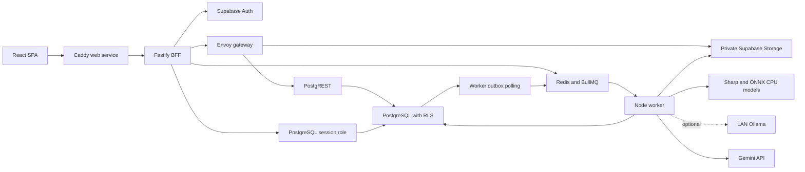

# Development Guide

This guide describes the current source tree. Historical audits and refactor reports record earlier states; use the paths below when adding code today. Start with [AGENTS.md](../../AGENTS.md), [architecture](../ARCHITECTURE.md), [code quality](../CODE_QUALITY.md), and [UI conventions](../ui-guidelines.md).

## Contents

1. [Project overview and feature map](#project-overview-and-feature-map)
2. [Repository structure](#repository-structure)
3. [Architecture and data flows](#architecture-and-data-flows)
4. [Where should I add new code?](#where-should-i-add-new-code)
5. [Frontend development](frontend-api.md#frontend-development)
6. [Backend and API development](frontend-api.md#backend-and-api-development)
7. [Database and Supabase development](database-jobs-ai.md#database-and-supabase-development)
8. [Background jobs and worker](database-jobs-ai.md#background-jobs-and-worker)
9. [AI and Gemini integration](database-jobs-ai.md#ai-and-gemini-integration)
10. [Internationalization](frontend-api.md#internationalization)
11. [Testing and quality checks](operations.md#testing-and-quality-checks)
12. [Local development and Docker](operations.md#local-development-and-docker)
13. [Configuration and environment variables](operations.md#configuration-and-environment-variables)
14. [Deployment and updates](operations.md#deployment-and-updates)
15. [Troubleshooting](operations.md#troubleshooting)
16. [Complete example: wardrobe reminders](feature-example.md)
17. [Development checklist](feature-example.md#development-checklist)

## Project overview and feature map

Smart Wardrobe is a self-hosted digital wardrobe: users organize photographed garments, share wardrobes, track laundry, generate outfits from owned garments, describe their style, and plan travel packing. React/Vite serves the SPA; Fastify is its only public application API. Supabase supplies Auth, PostgreSQL, PostgREST and private Storage. BullMQ/Redis carry background work; PostgreSQL retains durable job state. CPU models handle image processing/classification, optional Ollama handles analysis, and Gemini handles configured recommendation tasks.

Paths in the frontend column are relative to `apps/web/src/features/`; backend paths are relative to `apps/api/src/modules/`. Tables are business storage, not an exhaustive list of internal Supabase tables. Endpoint families include representative methods; consult each route file and the running OpenAPI at `/api/docs` for request details. Some handlers have no explicit response schema, so OpenAPI alone is not a complete contract reference.

| Feature                                 | Behavior / frontend                                                                      | API implementation and endpoints                                                                                                                                                   | Worker and storage                                                                                                     | Tests to start with                                                                                                           |
| --------------------------------------- | ---------------------------------------------------------------------------------------- | ---------------------------------------------------------------------------------------------------------------------------------------------------------------------------------- | ---------------------------------------------------------------------------------------------------------------------- | ----------------------------------------------------------------------------------------------------------------------------- |
| Authentication                          | Login, registration, recovery, remember-me; `auth/`                                      | `auth/routes.ts`, `auth/session.ts`; `POST /api/auth/login`, `/register`, `/refresh`, `/logout`, `/forgot-password`, `/password`; `GET /api/auth/me`, `/csrf`, `/verify`           | No worker; Supabase Auth, `private.sessions`, `profiles`; encrypted tokens stay server-side                            | `apps/api/src/modules/auth/__tests__/session.test.ts`, `tests/lan-auth.test.ts`, `tests/e2e/auth.spec.ts`                     |
| Dashboard                               | Wardrobe overview and activity; `dashboard/`                                             | Composes `GET /api/wardrobes`, `/api/garments`, `/api/analysis/activity`                                                                                                           | Reads wardrobe/garment/job data; no dedicated dashboard job                                                            | `tests/api.test.ts`, `tests/e2e/wardrobe.spec.ts`                                                                             |
| Digital wardrobe and garment management | Search, filters, favorites, details and editing; `catalog/`, `garments/`                 | `garments/routes.ts`; `GET/POST /api/garments`, `GET/PATCH/DELETE /api/garments/:id`; custom-property routes in `garments/custom-properties/`                                      | `garments`, `garment_images`, property definitions/options/values                                                      | `tests/custom-properties.test.ts`, `tests/custom-properties-rls.sql`, `tests/e2e/garment-detail-ux.spec.ts`                   |
| Garment upload                          | Single garment and bounded bulk import; `garments/`, `bulk-upload/`                      | `images/routes.ts`; `POST /api/garments/:id/images`, `GET /api/images/:id`                                                                                                         | Private `garments` Storage bucket, `garment_images`, `jobs`; image pipeline derives catalog/cutout/thumbnail           | `tests/images.test.ts`, `tests/bulk-api.test.ts`, `tests/bulk-upload.test.ts`                                                 |
| AI garment analysis                     | Review metadata and retry processing; `image-analysis/`, `analysis-activity/`            | `images/routes.ts`, `jobs/routes.ts`, `wardrobes/routes.ts`; `/api/jobs`, `POST /api/jobs/:id/retry`, `POST /api/wardrobes/:id/analyze`                                            | `jobs/processors.ts`, `jobs/garment-analysis/fashion.ts`, `integrations/ollama/providers.ts`; metadata and job records | `tests/providers.test.ts`, `tests/fashion.test.ts`, `tests/ai-preferences.test.ts`                                            |
| Outfit generation and saved outfits     | Recommendations, favorites/saved outfits; `outfits/`                                     | `gemini/task-routes.ts`, `outfits/routes.ts`; `POST /api/recommendations`, `GET/POST /api/outfits`, `DELETE /api/outfits/:id`; garment wear/history routes                         | `jobs/outfit-generation/gemini-outfits.ts`; `gemini_tasks`, `outfits`, `outfit_garments`, `wear_history`               | `tests/gemini-outfits.test.ts`, `tests/saved-outfit.test.ts`, `tests/outfit-engine.test.ts`, `tests/saved-outfit-rls.sql`     |
| Style questionnaire and profile         | 34 questions across seven sections, interpretation and summary; `style-profile/`         | `profile/routes.ts`; `GET/PATCH /api/profile/style`                                                                                                                                | No dedicated worker; `profiles.style_profile`; shared interpreter also supplies generator context                      | `tests/style-profile.test.ts`, `tests/style-profile-summary.test.ts`, feature `__tests__/`, `tests/e2e/style-profile.spec.ts` |
| Travel Packing                          | Trip form, complete checklist, garment matching and saved progress; `travel-packing/`    | `travel-packing/routes.ts`; `POST /api/travel-packing/generate`, `GET /api/travel-packing`, `PUT/DELETE /api/travel-packing/:id`, `GET /api/travel-packing/:id/recommendations`    | `jobs/travel-packing/generate.ts`; `packing_lists`, `gemini_tasks`; deterministic base plus Gemini enrichment          | `tests/travel-packing*.test.ts`, `tests/travel-packing-rls.sql`, feature `__tests__/`, `tests/e2e/travel-packing.spec.ts`     |
| Family and laundry                      | Membership, invitations, garment availability; `family/`, `laundry/`                     | `wardrobes/routes.ts`, `garments/routes.ts`, `outfits/routes.ts`; wardrobe members/invitations, garment PATCH and wear/history                                                     | `wardrobes`, `wardrobe_members`, `invitations`, `wear_history`; wardrobe deletion has asynchronous cleanup             | `tests/wardrobe-cleanup.test.ts`, `tests/stack.ts`                                                                            |
| Settings                                | Profile, wardrobe administration, AI preferences, encrypted Gemini settings; `settings/` | `profile/routes.ts`, `gemini/settings-routes.ts`; `PATCH /api/profile`, `GET/PATCH /api/preferences/ai`, `GET/PUT/DELETE /api/gemini/settings`, `PATCH /api/gemini/settings/model` | `profiles`, `gemini_credentials`; connection tests use Gemini tasks                                                    | `tests/gemini-provider.test.ts`, `tests/gemini-rls.sql`, `tests/e2e/gemini-settings.spec.ts`                                  |
| Internationalization                    | Explicit English/Polish selection; shared and feature locale files                       | No translation API; generated content receives a language in its request                                                                                                           | No translation job; saved generated prose keeps its original language                                                  | `apps/web/src/app/i18n/i18n.test.tsx`, `tests/e2e/language.spec.ts`, `scripts/i18n-check.mjs`                                 |

Read [Travel Packing](../travel-packing.md), [style profile](../style-profile.md), [sessions](../auth-sessions.md), [image pipeline](../image-pipeline.md), and [Gemini setup](../gemini-setup.md) for feature-specific invariants.

## Repository structure

```text
apps/
  web/src/
    app/{router,providers,i18n}/   bootstrap, routing, shared providers
    features/                    feature-owned pages, components, hooks, locales
    components/{layout,ui}/      shared navigation and reusable UI
    lib/                         cross-feature API, forms and utilities
    styles/                      application styles and theme tokens
    test/                        browser component-test setup
  api/src/
    app/                         Fastify assembly, config, origins, migrator
    modules/                     feature routes, sessions, storage and queues
    lib/                         shared route helpers
  worker/src/
    app/                         worker startup and queue policy
    jobs/                        processors, outbox, cleanup, outfit and packing jobs
    integrations/                Gemini and Ollama providers
    pipelines/images/            Sharp and ONNX processing
packages/shared/src/             pure schemas, contracts and domain rules
supabase/migrations/             ordered immutable SQL
infra/                          Dockerfiles, Caddy, models, mail, Storage, pinned Supabase
scripts/                        setup, Compose generation and quality checks
tests/                          Vitest, mocked browser scenarios and isolated SQL/stack tests
docs/                           architecture, operations, quality and feature references
.github/workflows/quality.yml    CI quality pipeline
```

Put business UI in its feature, not in `components/ui` or the root `src/`. Shared components must have multiple legitimate consumers; they must not import business features. API business modules own routes and authorization; `app/` wires modules and must not become a business-helper dumping ground. Worker integrations own provider protocols, while jobs own application orchestration. Shared code must stay pure: no database, network, React, or process-specific configuration. Migration files are schema history, not scratch SQL; proposed/unapplied SQL belongs in documented proposals under `docs/`. Generated artifacts, weights, user images, `.env`, and backups stay outside source control.

## Architecture and data flows



One root `docker-compose.yml` owns these services and persistent volumes. Compose is generated by `scripts/compose.mjs` using the pinned upstream configuration in `infra/supabase/`; read its provenance before changing upstream files. The browser calls relative `/api` URLs. Caddy proxies them; database, Redis and Supabase credentials never enter frontend configuration.

### User login

The auth form uses React Hook Form and shared Zod input validation. `lib/api/client.ts` obtains `/api/auth/csrf`, then submits to `/api/auth/login` with a CSRF header. Origin enforcement and rate limiting run in the BFF. Supabase verifies credentials. `modules/auth/session.ts` encrypts access/refresh tokens into server-side session storage and sets an HttpOnly cookie; remember-me controls persistence. Authenticated handlers call `session.load(req, reply)` to obtain `user` and a Supabase client carrying that user's access token. Browser storage holds UI preferences, not Supabase tokens. See [session lifetime and refresh](../auth-sessions.md).

### Adding a garment

The garment form creates the metadata row through `POST /api/garments`. Photo upload is a separate multipart request to `POST /api/garments/:id/images`. The API validates file limits, permissions and image data, writes the private original and image metadata, and schedules durable work through SQL. `pipelines/images/pipeline.ts` creates derived assets; the catalog can show a pending garment before processing finishes. SQL and object Storage are not one atomic transaction; preserve retry/cleanup behavior. Bulk upload limits pending work and retains unsent files in browser memory.

### AI garment analysis

Image processing and metadata analysis use separate jobs and queues. The worker dispatches persisted IDs, reloads authorized data, and calls FashionSigLIP or optional Ollama; analysis is not a Gemini requirement. Shared normalization/validation protects metadata. Manual rotation and user changes take priority under the existing version/review rules. The `ai_overwrite_metadata` setting controls supported subsequent overwrites; an analysis result is not unconditional permission to replace user input.

### Outfit generation

`features/outfits/pages/outfits.tsx` sends criteria, wardrobe ID and content language to `POST /api/recommendations`. The BFF checks access and Gemini configuration, creates a durable `gemini_tasks` row and enqueues its ID. The worker loads controlled wardrobe/profile context and calls `jobs/outfit-generation/gemini-outfits.ts` through the common Gemini provider/limiter. It validates JSON and garment IDs before persisting task results. The frontend polls `/api/gemini/tasks/:id`. Saving an outfit is a separate `POST /api/outfits`; generating already writes task state, even without saving the outfit.

### Travel Packing

The trip form sends destination, positive days, optional date and preferences to `/api/travel-packing/generate`. Shared catalog/rules establish individual essentials independently of Gemini. The worker enriches that base, validates quantities/types, merges duplicates and restores missing essentials; provider failure can return a clearly labelled baseline. On completion, the frontend automatically persists a packing list through PUT. The UI loads authorized wardrobe recommendations and edits a local checklist before subsequent explicit saves through `PUT /api/travel-packing/:id`. Read `usePackingList.ts` before changing persistence behavior: required, assigned and packed counts are distinct. No forecast service exists; climate advice must not claim verified weather. Saved-list reads do not rerun completeness repair or AI. Garment assignments are checked against existing accessible records, never trusted model IDs.

## Where should I add new code?

| I want to…              | Start here                                                                                                        | Also update                                                                                         |
| ----------------------- | ----------------------------------------------------------------------------------------------------------------- | --------------------------------------------------------------------------------------------------- |
| Add a page              | `apps/web/src/features/<feature>/pages/`; register in `apps/web/src/app/router/main.tsx`                          | Feature `index.ts`, `components/layout/app-navigation.tsx`, navigation locales, route/browser tests |
| Add a feature component | Its feature's `components/`; reusable primitives in `apps/web/src/components/ui/`                                 | Accessibility, theme classes, component tests                                                       |
| Add a form              | Feature component plus shared input schema in `packages/shared/src/` when crossing API boundaries                 | RHF Zod resolver, localized validation, endpoint and tests                                          |
| Fetch or mutate data    | `apps/web/src/lib/api/client.ts`; feature-specific API files such as `features/travel-packing/api/packing-api.ts` | Response schema, query keys and invalidation, localized errors                                      |
| Add an API endpoint     | `apps/api/src/modules/<feature>/routes.ts`; register from `apps/api/src/app/app.ts`                               | Shared schema, session/RLS checks, API tests, frontend caller                                       |
| Add a table             | Next ordered `supabase/migrations/NNNN_description.sql`                                                           | RLS, grants, indexes, shared runtime schemas, two-user SQL tests                                    |
| Add background work     | `apps/worker/src/jobs/`, `jobs/outbox/outbox-dispatcher.ts`, `app/worker.ts`                                      | Durable SQL producer, `app/queue-policy.ts`, cancellation/retry tests                               |
| Add an AI feature       | `apps/worker/src/integrations/gemini/` and a feature job under `jobs/`                                            | Shared request/output schemas, BFF producer, quotas, credentials, mocked tests                      |
| Add a translation       | Feature `locales/en.json` and `pl.json`; shared `apps/web/src/locales/{en,pl}/`                                   | Register new namespace in `app/i18n/index.ts`, run `pnpm check:i18n`                                |
| Add a setting           | `apps/web/src/features/settings/`, `apps/api/src/modules/profile/routes.ts`                                       | Shared validation, authorized persistence/migration, both locales                                   |
| Change deployment       | `scripts/compose.mjs`, applicable `infra/` config, `.env.example`                                                 | Regenerate Compose, configuration validation, operations documentation                              |
